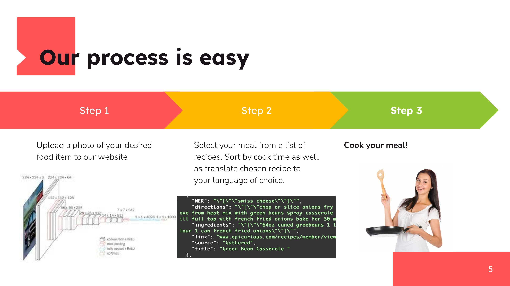
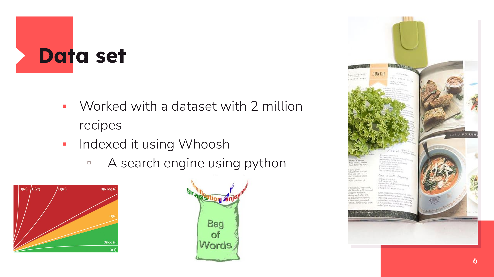
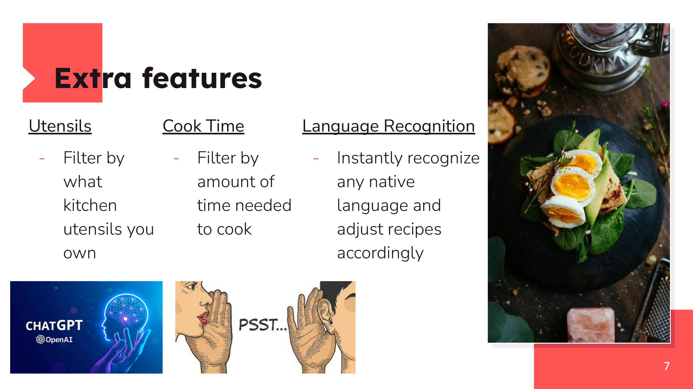

# Project Cook

_Final project for Le Wagon Data Science bootcamp._








## Streamlit deployment

The repository now ships with a ready-to-use Streamlit front-end located in
[`streamlit_app.py`](streamlit_app.py). The entry point relies on a couple of
optional assets – a trained TensorFlow model for the image classifier and a CSV
dataset for the recipe search index. The interface surfaces clear error
messages when those assets are missing so you can supply them in the environment
that suits your deployment best.

### Configuration

Provide the following environment variables (or `secrets.toml` entries) to
point the application towards your assets:

| Variable | Description |
| --- | --- |
| `COOK_MODEL_PATH` | Path to the TensorFlow `.h5` weights file. Defaults to `notebooks/model.h5`. |
| `COOK_LABELS_PATH` | Optional JSON file containing the class labels. Can be a list (`["pizza", "salad"]`) or a dictionary mapping indices to names. |
| `COOK_TRAIN_IMAGE_DIR` | Folder containing the training images (used to infer label names when `COOK_LABELS_PATH` is not supplied). |
| `COOK_DATASET_PATH` | CSV file with the recipe dataset. Defaults to `project_cook/data/full_dataset.csv`. |
| `COOK_INDEX_DIR` | Directory where the Whoosh search index should be stored. Defaults to `new_index`. |

Only the model path is required to unlock image predictions. Recipe search works
when a dataset is provided; the index is created automatically on first use.

### Running locally

Install the dependencies and start Streamlit:

```bash
pip install -r requirements.txt
streamlit run streamlit_app.py
```

When deploying to Streamlit Cloud make sure the above environment variables are
configured in the project settings.
